# Deep Dive into React and MUI Architecture

> **Author**: Senior React Engineer & Open-Source Architecture Specialist  
> **Audience**: Senior Developers, Tech Leads, and Open-Source Contributors  
> **Target Framework Versions**: React 18 / 19 & Material UI (MUI) v5 / v6  

---

## Table of Contents
1. [React Internal Architecture](#1-react-internal-architecture)
2. [MUI Monorepo and Package Structure](#2-mui-monorepo-and-package-structure)
3. [Internal Implementation of a MUI Component](#3-internal-implementation-of-a-mui-component)
4. [MUI Slot Architecture](#4-mui-slot-architecture)
5. [MUI Styling and Theme Engine](#5-mui-styling-and-theme-engine)
6. [React Hooks and MUI Utilities](#6-react-hooks-and-mui-utilities)
7. [End-to-End Component Rendering Flow](#7-end-to-end-component-rendering-flow)
8. [Production React + MUI Application Structure](#8-production-react--mui-application-structure)
9. [Architecture Diagrams](#9-architecture-diagrams)
10. [Final Comparison Table & Open-Source Contribution Roadmap](#10-final-comparison-table--open-source-contribution-roadmap)

---

## 1. React Internal Architecture

React is not a monolithic library; it is a decoupled ecosystem of packages that separate **declarative UI specification**, **cooperative scheduling**, **tree reconciliation**, and **platform-specific rendering**.

### Package Decoupling & Source Directory Tree

In the official [facebook/react](https://github.com/facebook/react) monorepo, responsibilities are split across modular packages:

```text
react/
├── packages/
│   ├── react/                      # Public API surface (isomorphic)
│   │   ├── src/
│   │   │   ├── React.js            # Exports: createElement, Component, hooks
│   │   │   ├── ReactHooks.js       # Hook delegators to ReactCurrentDispatcher
│   │   │   ├── ReactContext.js     # createContext implementation
│   │   │   └── ReactSharedInternals.js
│   ├── react-reconciler/           # Platform-agnostic Fiber reconciliation engine
│   │   ├── src/
│   │   │   ├── ReactFiber.js       # Fiber node constructor & data structure
│   │   │   ├── ReactFiberWorkLoop.js # performUnitOfWork, render/commit loops
│   │   │   ├── ReactFiberBeginWork.js# Component diffing & child instantiation
│   │   │   ├── ReactFiberCompleteWork.js# DOM node assembly & event registration
│   │   │   ├── ReactFiberCommitWork.js # Mutation, layout, & passive effect execution
│   │   │   ├── ReactFiberHooks.js  # Mount & Update hook dispatcher implementations
│   │   │   └── ReactFiberLane.js   # 31-bit Lane priority bitmasks
│   ├── scheduler/                  # Cooperative task queue & time-slicing
│   │   ├── src/
│   │   │   ├── Scheduler.js        # Priority queue (min-heap) & work loop
│   │   │   ├── SchedulerMinHeap.js # Binary heap implementation for tasks/timers
│   │   │   └── forks/              # Platform timer abstractions (MessageChannel)
│   ├── react-dom/                  # Browser host environment adapter
│   │   ├── src/
│   │   │   ├── client/             # createRoot, hydrateRoot, ReactDOMComponent
│   │   │   └── events/             # SyntheticEvent dispatch & event plugins
│   └── shared/                     # Cross-package constants, invariants, ReactSymbols
```

### Core Responsibilities

#### 1. `react`
- **Scope**: Platform-independent and environment-agnostic.
- **Role**: Exposes the declarative API used by developers: `createElement`, `cloneElement`, `createContext`, `forwardRef`, `memo`, and hooks (`useState`, `useEffect`, etc.).
- **Mechanism**: The `react` package contains **no reconciliation or rendering logic**. When you invoke `useState()`, `react/src/ReactHooks.js` delegates the call to:
  ```js
  const dispatcher = ReactSharedInternals.ReactCurrentDispatcher.current;
  return dispatcher.useState(initialState);
  ```
  The active dispatcher is dynamically injected at runtime by the active reconciler (`react-reconciler`).

#### 2. `react-reconciler` (The Fiber Architecture)
- **Scope**: Reconciles virtual tree differences without knowing whether the host is a browser, a mobile view (React Native), a terminal, or WebGL.
- **The Fiber Node**: Every React element is backed by a `FiberNode` object:
  ```ts
  interface Fiber {
    tag: WorkTag;              // FunctionComponent, ClassComponent, HostComponent, etc.
    key: null | string;
    elementType: any;          // Function reference or string ('div')
    type: any;
    stateNode: any;            // Actual DOM node or instance reference

    return: Fiber | null;      // Parent Fiber (return target after completion)
    child: Fiber | null;       // First child Fiber
    sibling: Fiber | null;     // Next sibling Fiber
    index: number;

    pendingProps: any;         // Input props for the current render pass
    memoizedProps: any;        // Props from the previous committed pass
    memoizedState: any;        // Singly linked list of Hooks (for function components)
    updateQueue: any;          // State updates & side effects queue

    lanes: Lanes;              // Priority bitmask for pending work on this fiber
    childLanes: Lanes;

    alternate: Fiber | null;   // Double-buffering pointer to opposing tree counterpart
    flags: Flags;              // Placement, Update, Deletion, Passive, etc.
    subtreeFlags: Flags;       // Subtree effect accumulation for O(1) bailouts
  }
  ```
- **Double-Buffering**: React maintains two Fiber trees simultaneously:
  1. `current`: The tree currently visible on the screen.
  2. `workInProgress` (`WIP`): The alternate tree being assembled in memory during the render phase.
  Upon finishing the render phase, React commits the `WIP` tree to the host DOM and swaps a single pointer (`root.current = workInProgress`), achieving instantaneous zero-flicker frame switches.

#### 3. `scheduler`
- **Scope**: Prevents main thread starvation using cooperative multitasking.
- **Mechanism**: Breaks work into 5ms execution slices. It uses `MessageChannel` (falling back to `setTimeout`) rather than `requestAnimationFrame` because `MessageChannel` executes immediately after browser paint and layout, avoiding unnecessary v-sync throttling.
- **Priority System**: Scheduler manages tasks using a min-heap sorted by expiration time:
  - `ImmediatePriority` (-1ms expiration delta)
  - `UserBlockingPriority` (250ms expiration delta — clicks, typing)
  - `NormalPriority` (5,000ms expiration delta — network updates, animations)
  - `LowPriority` (10,000ms expiration delta)
  - `IdlePriority` (never expires unless idle)

#### 4. `react-dom`
- **Scope**: Implements the HostConfig interface defined by `react-reconciler` for web browsers.
- **Operations**: `createInstance` (`document.createElement`), `appendInitialChild` (`parent.appendChild`), `commitUpdate` (mutating node attributes, styles, textContent), and Synthetic Event delegation (attaching listeners at the root container rather than individual DOM nodes).

---

### How Function Components Render and Update

When a state transition occurs (e.g. `setCount(c => c + 1)`):
1. **Enqueueing**: The hook creates an `Update` object containing the lane priority and action, appending it to the hook's circular update queue.
2. **Scheduling**: `markUpdateLaneFromFiberToRoot()` traverses upwards, marking `lanes` and `childLanes` on all ancestor fibers. The reconciler notifies the Scheduler to schedule a microtask/task.
3. **Work Loop**: The Scheduler triggers `performConcurrentWorkOnRoot`.
4. **Render Phase (`beginWork`)**:
   - `updateFunctionComponent()` executes.
   - React sets the dispatcher:
     - On mount: `ReactCurrentDispatcher.current = HooksDispatcherOnMount`
     - On update: `ReactCurrentDispatcher.current = HooksDispatcherOnUpdate`
   - The component function is executed: `children = Component(props, refOrContext)`.
   - Child elements undergo reconciliation against existing child fibers via `reconcileChildFibers()`.
5. **Completion Phase (`completeWork`)**:
   - Bubbles up from leaf nodes to the root.
   - Computes style/attribute diffs and accumulates `subtreeFlags`.
6. **Commit Phase (`commitRoot`)**:
   - Synchronous and non-interruptible.
   - `commitMutationEffects`: DOM insertions, updates, and deletions occur.
   - Root pointer swaps: `root.current = workInProgress`.
   - `commitLayoutEffects`: Synchronous `useLayoutEffect` execution and ref assignment.
7. **Passive Phase**:
   - Asynchronously schedules `useEffect` cleanup and setup callbacks via `Scheduler_scheduleCallback(NormalPriority, flushPassiveEffects)`.

---

### How Core Hooks Work Under the Hood

In function components, `fiber.memoizedState` holds a **singly linked list** of `Hook` records:

```ts
interface Hook {
  memoizedState: any;       // Current state or effect descriptor
  baseState: any;           // State before baseQueue updates
  baseQueue: Update | null; // Updates that weren't processed due to priority
  queue: UpdateQueue | null;// Pending updates enqueued by setState
  next: Hook | null;        // Pointer to the next hook in declaration order
}
```

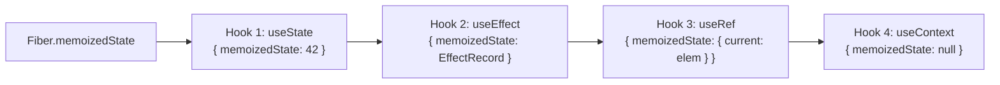

- **`useState`**:
  - `mountState`: Initializes `{ memoizedState: initialValue, queue: { pending: null } }`. Returns `[hook.memoizedState, dispatchSetState.bind(null, fiber, queue)]`.
  - `updateState`: Iterates through the `queue.pending` circular linked list, applies update reducers matching the current render lanes, computes new state, and saves it to `hook.memoizedState`.
- **`useEffect`**:
  - `mountEffectImpl` / `updateEffectImpl`: Compares dependency arrays (`areHookInputsEqual`). If dependencies changed or are null, pushes an `Effect` node (`{ tag: Passive | HookHasEffect, create, destroy, deps, next }`) to `fiber.updateQueue.lastEffect`.
  - It runs **after paint** through Scheduler's message channel callback.
- **`useRef`**:
  - `mountRef(initialValue)`: Creates a plain JavaScript object `{ current: initialValue }` and stores it directly on `hook.memoizedState`.
  - `updateRef()`: Simply returns `hook.memoizedState`. Because the hook record persists across renders on the Fiber, the reference remains identity-stable.
- **`useContext`**:
  - Does not allocate a persistent hook record in the linked list. Instead, it reads `context._currentValue` and registers a `ContextDependency` on `fiber.dependencies`.
  - When a `<Context.Provider value={nextValue}>` changes, `propagateContextChange()` scans descendant fibers, detects matching dependencies, and schedules updates on them even through `React.memo` boundaries.

---

## 2. MUI Monorepo and Package Structure

Material UI is maintained in the [mui/material-ui](https://github.com/mui/material-ui) monorepo. It cleanly bifurcates design system styling engines, core headless logic, Material Design components, and advanced enterprise widgets.

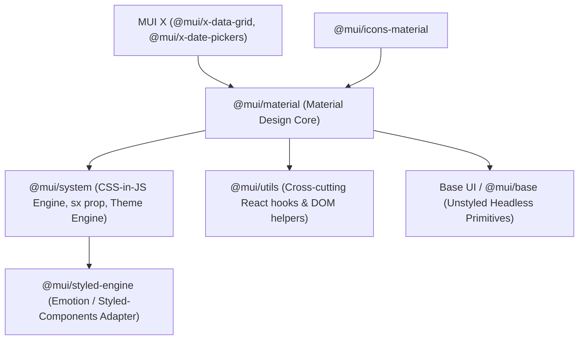

### Major Package Responsibilities

| Package | Primary Responsibility | Key Modules / Exports |
|---|---|---|
| `@mui/material` | Official implementation of Google Material Design specifications in React. | `Button`, `TextField`, `Dialog`, `Typography`, `useThemeProps` |
| `@mui/system` | Styling engine, theme resolution, breakpoints, spacing, and the `sx` prop engine. | `createTheme`, `styled`, `Box`, `styleFunctionSx`, `useTheme` |
| `@mui/utils` | Shared internal utilities, hooks, and DOM manipulation algorithms. | `useForkRef`, `useControlled`, `useEnhancedEffect`, `composeClasses` |
| `@mui/styled-engine` | Abstraction layer isolating MUI from concrete CSS-in-JS libraries. Defaults to Emotion. | Wrapped `styled()`, `css`, `keyframes`, `ThemeContext` |
| `@mui/base` (Base UI) | Headless UI primitives providing unstyled accessibility (WAI-ARIA) and state hooks. | `useButton`, `useSelect`, `ClickAwayListener`, `Portal` |
| `@mui/icons-material` | ~2,100 SVG icon components generated from Google Material Icons. | `SvgIcon`, `Menu`, `Close`, `Search`, etc. |
| MUI X (`@mui/x-*`) | Advanced, high-performance data-heavy components (virtualized grids, charts, schedulers). | `DataGridPro`, `DatePicker`, `DateRangePicker`, `Charts` |

### Representative Component Source Structure (`Button`)

Inside `@mui/material/src/Button`:

```text
packages/mui-material/src/Button/
├── Button.js               # Primary component implementation & styled slots
├── Button.d.ts             # TypeScript definitions, prop types, & slot interface
├── ButtonClasses.ts        # BEM-like class generators (getButtonUtilityClass)
├── buttonClasses.ts        # Exported class constants ('MuiButton-root', etc.)
├── index.js                # Public barrel export
├── index.d.ts              # Type re-exports
└── Button.test.js          # Unit, integration, & accessibility test suite
```

### Responsibility Matrix: React vs. MUI

- **React Owns**:
  - Component lifecycle, Fiber tree construction, DOM reconciliation.
  - State scheduling, hook linked-list storage, priority Lane calculations.
  - Synthetic event routing and batched DOM mutations.
- **MUI Owns**:
  - Theme structure, design tokens (palette, spacing, breakpoints, typography).
  - CSS generation, style sheet injection into `<style>` tags via `@mui/styled-engine`.
  - WAI-ARIA conformance, focus rings, ripples, and keyboard accessibility.
  - Class name composition (`MuiButton-containedPrimary`) and polymorphic slot rendering.

---

## 3. Internal Implementation of a MUI Component

Let's dissect how the MUI `Button` executes internally from invocation to DOM dispatch.

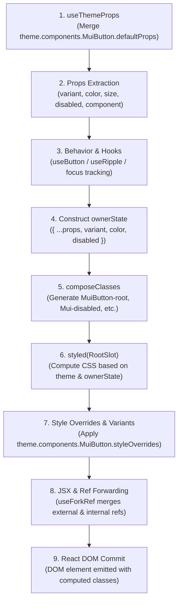

### Step-by-Step Code Walkthrough

#### Step 1 & 2: Resolving Props and Theme Defaults via `useThemeProps`
Every MUI component begins by querying the active theme for global defaults configured via `theme.components.MuiButton.defaultProps`:

```tsx
// Inside Button.tsx
const Button = React.forwardRef<HTMLButtonElement, ButtonProps>((inProps, ref) => {
  // Merges theme defaultProps with inline component props
  const props = useThemeProps({
    props: inProps,
    name: 'MuiButton',
  });

  const {
    children,
    color = 'primary',
    component = 'button',
    disabled = false,
    disableElevation = false,
    disableFocusRipple = false,
    endIcon: endIconProp,
    focusVisibleClassName,
    fullWidth = false,
    size = 'medium',
    startIcon: startIconProp,
    type,
    variant = 'text',
    ...other
  } = props;
```

#### Step 3: Managing Behavior and State
The component tracks focus visibility, ripples, and disabled interactions:

```tsx
  const buttonRef = React.useRef<HTMLButtonElement>(null);
  const handleRef = useForkRef(buttonRef, ref);

  // Ripple state handler
  const {
    enableTouchRipple,
    getRippleHandlers,
  } = useRippleBehavior({ disabled, disableRipple: props.disableRipple });
```

#### Step 4: Constructing `ownerState`
`ownerState` is a clean, immutable snapshot of the component's resolved props and derived internal state. It is passed into styled components and override resolvers:

```tsx
  const ownerState: ButtonOwnerState = {
    ...props,
    color,
    component,
    disabled,
    disableElevation,
    disableFocusRipple,
    fullWidth,
    size,
    variant,
  };
```

#### Step 5: Generating Utility Classes via `composeClasses`
MUI generates global class names without hardcoded string concatenations:

```tsx
  const useUtilityClasses = (ownerState: ButtonOwnerState) => {
    const { color, disableElevation, fullWidth, size, variant, disabled } = ownerState;

    const slots = {
      root: [
        'root',
        variant,
        `${variant}${capitalize(color)}`,
        `size${capitalize(size)}`,
        `${variant}Size${capitalize(size)}`,
        color === 'inherit' && 'colorInherit',
        disableElevation && 'disableElevation',
        fullWidth && 'fullWidth',
        disabled && 'disabled',
      ],
      startIcon: ['startIcon', `iconSize${capitalize(size)}`],
      endIcon: ['endIcon', `iconSize${capitalize(size)}`],
    };

    const getButtonUtilityClass = (slot: string) => `MuiButton-${slot}`;

    // composeClasses maps slots to final classes: MuiButton-root, MuiButton-contained, etc.
    return composeClasses(slots, getButtonUtilityClass, props.classes);
  };

  const classes = useUtilityClasses(ownerState);
```

#### Step 6 & 7: Defining Styled Slots with `styled()`
The Root slot is declared outside the render loop using `@mui/material/styles`:

```tsx
const ButtonRoot = styled(ButtonBase, {
  name: 'MuiButton',
  slot: 'Root',
  overridesResolver: (props, styles) => {
    const { ownerState } = props;
    return [
      styles.root,
      styles[ownerState.variant],
      styles[`${ownerState.variant}${capitalize(ownerState.color)}`],
      styles[`size${capitalize(ownerState.size)}`],
    ];
  },
})<{ ownerState: ButtonOwnerState }>(({ theme, ownerState }) => ({
  ...theme.typography.button,
  minWidth: 64,
  padding: '6px 16px',
  borderRadius: (theme.shape.borderRadius as number),
  transition: theme.transitions.create(
    ['background-color', 'box-shadow', 'border-color', 'color'],
    { duration: theme.transitions.duration.short }
  ),
  ...(ownerState.variant === 'contained' && {
    color: theme.palette[ownerState.color]?.contrastText,
    backgroundColor: theme.palette[ownerState.color]?.main,
    boxShadow: theme.shadows[2],
    '&:hover': {
      backgroundColor: theme.palette[ownerState.color]?.dark,
      boxShadow: theme.shadows[4],
    },
  }),
  ...(ownerState.disabled && {
    color: theme.palette.action.disabled,
    boxShadow: theme.shadows[0],
    backgroundColor: theme.palette.action.disabledBackground,
  }),
}));
```

#### Step 8 & 9: Emitting JSX and DOM Mutation
```tsx
  return (
    <ButtonRoot
      as={component}
      ref={handleRef}
      className={clsx(classes.root, props.className)}
      ownerState={ownerState}
      disabled={disabled}
      type={type}
      {...other}
    >
      {startIcon}
      {children}
      {endIcon}
    </ButtonRoot>
  );
});
```

---

## 4. MUI Slot Architecture

MUI separates compound components into dedicated, styled **slots** rather than monolithic elements.

```mermaid
graph TD
    subgraph TextField Component
        RootSlot["Root Slot: FormControl"]
        InputLabelSlot["Label Slot: InputLabel"]
        InputSlot["Input Slot: OutlinedInput"]
        subgraph OutlinedInput Compound
            NotchedOutlineSlot["NotchedOutline"]
            InputElementSlot["HTML <input>"]
            AdornmentSlot["InputAdornment (start/end)"]
        end
        HelperTextSlot["HelperText Slot: FormHelperText"]
    end
    RootSlot --> InputLabelSlot
    RootSlot --> InputSlot
    InputSlot --> NotchedOutlineSlot
    InputSlot --> InputElementSlot
    InputSlot --> AdornmentSlot
    RootSlot --> HelperTextSlot
```

### 1. `ownerState` as State Transportation Vector
In standard Emotion or styled-components, props passed to a styled component appear in the DOM unless filtered. MUI solves this cleanly:
- `ownerState` is intercepted by MUI's `styled` wrapper.
- It is passed to dynamic style functions: `({ theme, ownerState }) => ({ ... })`.
- It is **prevented from leaking into HTML attributes** on the underlying DOM node.

### 2. Slot Customization via `slots` and `slotProps`
In MUI v5 (migrated from `components` / `componentsProps`) and standardized in MUI v6:

```tsx
<TextField
  label="Departure City"
  slots={{
    input: CustomOutlinedInput,
  }}
  slotProps={{
    input: {
      endAdornment: <InputAdornment position="end"><LocationCityIcon /></InputAdornment>,
    },
    htmlInput: {
      'aria-label': 'Departure city address',
      autoComplete: 'off',
    },
  }}
/>
```

### 3. Polymorphism via `component` Prop
MUI components support runtime DOM tag switching while maintaining all theme and variant styling:

```tsx
import { Link as RouterLink } from 'react-router-dom';

// Renders an HTML <a> tag with all Button styles, behaviors, and accessibility attributes
<Button component={RouterLink} to="/analytics" variant="contained">
  View Live Telemetry
</Button>
```

### 4. Accessibility and Keyboard Handling
- **ARIA Synchronizations**: When `disabled={true}`, MUI adds `aria-disabled="true"` and `tabIndex={-1}`.
- **Focus Rings**: Uses the CSS `:focus-visible` pseudo-class (via the `useIsFocusVisible` hook) so focus outlines appear on keyboard tab navigation but stay hidden on mouse clicks.
- **Dialog Traps**: `Dialog` utilizes `Modal`, which integrates `FocusTrap` to prevent keyboard focus from cycling out of active modal DOM nodes, and `Portal` to mount dialogs at `document.body` level.

---

## 5. MUI Styling and Theme Engine

### Style Flow Pipeline

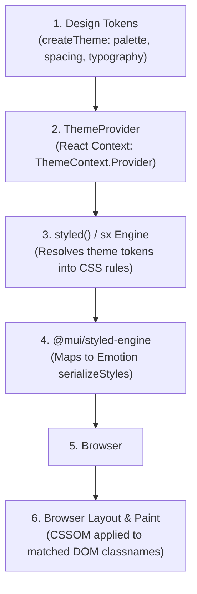

### 1. `createTheme` Token Architecture
A MUI theme is an immutable hierarchical JavaScript tree constructed with deep merging:

```ts
const theme = createTheme({
  palette: {
    mode: 'dark',
    primary: {
      main: '#0284c7',
      dark: '#0369a1',
      contrastText: '#ffffff',
    },
    background: {
      default: '#0f172a',
      paper: '#1e293b',
    },
  },
  spacing: 8, // base spacing multiplier: theme.spacing(2) => '16px'
  breakpoints: {
    values: { xs: 0, sm: 600, md: 900, lg: 1200, xl: 1536 },
  },
  components: {
    MuiButton: {
      defaultProps: {
        disableElevation: true,
      },
      styleOverrides: {
        root: {
          textTransform: 'none',
          borderRadius: 8,
        },
      },
    },
  },
});
```

### 2. The `sx` Prop and `styleFunctionSx`
The `sx` prop is a superset of CSS that performs fast runtime token lookup and responsive array/object expansion:

```tsx
<Box
  sx={{
    p: [2, 3, 4],                        // Responsive array: theme.spacing at [xs, sm, md]
    color: 'primary.main',               // Path resolution: theme.palette.primary.main
    bgcolor: 'background.paper',
    boxShadow: 3,                        // theme.shadows[3]
    display: 'flex',
    flexDirection: { xs: 'column', md: 'row' }, // Responsive object notation
  }}
>
  Telemetry Stream
</Box>
```

#### Under the Hood of `styleFunctionSx`
1. **Property Lookup**: Matches property keys against internal style configs (`spacing`, `palette`, `typography`, `borders`).
2. **Value Transformation**: If the property is `margin` or `padding`, passes integer values to `theme.spacing()`.
3. **Responsive Mapping**: Detects breakpoints and produces CSS media query blocks:
   ```css
   @media (min-width: 600px) { padding: 24px; }
   @media (min-width: 900px) { padding: 32px; }
   ```
4. **Caching**: Style objects are passed to Emotion's `serializeStyles()`, generating a deterministic class name (e.g. `css-1x4df8e`) and injecting it into the DOM `<style>` sheet.

---

## 6. React Hooks and MUI Utilities

MUI ships a suite of robust low-level hooks in `@mui/utils` that solve complex edge cases in enterprise React development.

### 1. `useForkRef`
- **Problem**: A component needs an internal ref (for measurements, focus, or ripple effects) while simultaneously forwarding an external `ref` supplied by the consumer.
- **Classification**: Internal utility (`@mui/utils`).
- **Implementation**:
  ```ts
  function setRef<T>(ref: React.Ref<T> | null | undefined, value: T) {
    if (typeof ref === 'function') {
      ref(value);
    } else if (ref) {
      (ref as React.MutableRefObject<T>).current = value;
    }
  }

  export function useForkRef<T>(
    refA: React.Ref<T> | null | undefined,
    refB: React.Ref<T> | null | undefined
  ): React.RefCallback<T> | null {
    return React.useMemo(() => {
      if (refA == null && refB == null) return null;
      return (refValue: T) => {
        setRef(refA, refValue);
        setRef(refB, refValue);
      };
    }, [refA, refB]);
  }
  ```

### 2. `useControlled`
- **Problem**: Components often need to support both **controlled** mode (parent passes `value` + `onChange`) and **uncontrolled** mode (parent passes `defaultValue` or nothing). Switching between them mid-lifecycle causes React warnings.
- **Classification**: Internal utility (`@mui/utils`).
- **Implementation**:
  ```ts
  export function useControlled<T>({
    controlled,
    default: defaultProp,
    name,
    state = 'value',
  }: {
    controlled: T | undefined;
    default: T | undefined;
    name: string;
    state?: string;
  }): [T, (newValue: T | ((prev: T) => T)) => void] {
    const { current: isControlled } = React.useRef(controlled !== undefined);
    const [valueState, setValue] = React.useState(defaultProp);
    const value = isControlled ? (controlled as T) : (valueState as T);

    const setValueIfUncontrolled = React.useCallback((newValue: T | ((prev: T) => T)) => {
      if (!isControlled) {
        setValue(newValue);
      }
    }, [isControlled]);

    return [value, setValueIfUncontrolled];
  }
  ```

### 3. `useEnhancedEffect`
- **Problem**: `useLayoutEffect` produces warnings during Server-Side Rendering (SSR / Next.js) because the server has no layout engine.
- **Classification**: Internal utility (`@mui/utils`).
- **Implementation**:
  ```ts
  export const useEnhancedEffect =
    typeof window !== 'undefined' ? React.useLayoutEffect : React.useEffect;
  ```

### 4. `useEventCallback`
- **Problem**: Passing event listener callbacks to DOM or subscriptions without re-triggering child re-renders or effect re-runs when dependencies change.
- **Classification**: Internal utility (`@mui/utils`).
- **Implementation**:
  ```ts
  export function useEventCallback<Args extends unknown[], Return>(
    fn: (...args: Args) => Return
  ): (...args: Args) => Return {
    const ref = React.useRef(fn);
    useEnhancedEffect(() => {
      ref.current = fn;
    });
    return React.useCallback((...args: Args) => ref.current(...args), []);
  }
  ```

### 5. `useThemeProps`
- **Problem**: Components need access to the theme's `components[Name].defaultProps` overrides before prop destructuring.
- **Classification**: Public API (`@mui/material/styles`).
- **Implementation Concept**: Resolves `theme.components[name].defaultProps` and shallow merges them under `inProps`.

### 6. `useMediaQuery`
- **Problem**: Dynamic responsiveness in JS space (e.g. rendering a drawer vs app bar).
- **Classification**: Public API (`@mui/material/useMediaQuery`).
- **Mechanism**: Attaches a listener to `window.matchMedia(query)` using `useSyncExternalStore` (React 18+) for tearing-free viewport synchronization.

---

## 7. End-to-End Component Rendering Flow

What happens when an application executes:

```tsx
<ThemeProvider theme={customTheme}>
  <Button variant="contained" color="primary">
    Analyze Corridor
  </Button>
</ThemeProvider>
```

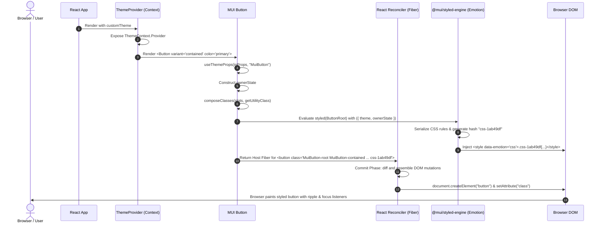

---

## 8. Production React + MUI Application Structure

A scalable, enterprise-grade architecture for large React + TypeScript applications:

```text
src/
├── app/
│   ├── App.tsx                     # Top-level application shell
│   ├── providers.tsx               # ThemeProvider, Redux, QueryClient, Router composition
│   └── store.ts                    # Redux Toolkit configureStore
├── theme/
│   ├── index.ts                    # createTheme export with design tokens
│   ├── palette.ts                  # Color palettes (light / dark)
│   ├── typography.ts               # Typography hierarchies & scale
│   ├── components/                 # Component defaultProps & styleOverrides
│   │   ├── button.ts
│   │   ├── textField.ts
│   │   └── dialog.ts
│   └── tokens.ts                   # Raw primitive hex codes and constants
├── components/                     # Reusable design system primitives
│   ├── common/
│   │   ├── AppButton/              # Wrapped enterprise Button with telemetry
│   │   ├── PageHeader/
│   │   └── StatusChip/
│   └── forms/
│       ├── FormTextField/          # Hook-form integrated TextField
│       └── FormSelect/
├── features/                       # Domain-driven feature modules
│   ├── routing/                    # Weather-aware routing feature
│   │   ├── components/             # Feature-specific UI (RouteCard, RouteMap)
│   │   ├── hooks/                  # Feature hooks (useRoutingEngine)
│   │   ├── routingSlice.ts         # Redux state slice
│   │   ├── types.ts                # Domain models
│   │   └── api.ts                  # Axios / fetch service calls
│   └── fleet/                      # Truck / fleet management feature
├── hooks/                          # Cross-feature utility hooks (useAuth, useDebounce)
├── services/                       # HTTP client instances (Axios base configuration)
├── routes/                         # React Router route tree definitions
├── layouts/                        # AppLayout, DashboardLayout, AuthLayout
├── utils/                          # Pure business and formatting utilities
└── main.tsx                        # ReactDOM.createRoot entry point
```

### Architectural Rules

1. **Dependency Inversion**:
   - `features` can import from `components/common`, `theme`, `hooks`, and `utils`.
   - `components/common` **cannot** import from `features`.
   - Features cannot import from other sibling features directly; shared logic must be hoisted to `services`, `store`, or `components`.
2. **Preventing Circular Dependencies**:
   - Avoid cross-importing from index barrel files within the same directory.
   - Use absolute TypeScript path aliases (`@theme/*`, `@components/*`, `@features/*`).

---

### Practical Production Code Examples

#### 1. Customized Theme Definition
```ts
// src/theme/index.ts
import { createTheme, responsiveFontSizes } from '@mui/material/styles';
import { buttonOverrides } from './components/button';

export const appTheme = responsiveFontSizes(
  createTheme({
    palette: {
      mode: 'light',
      primary: { main: '#0284c7', contrastText: '#ffffff' },
      secondary: { main: '#64748b' },
      error: { main: '#ef4444' },
      warning: { main: '#f59e0b' },
      success: { main: '#10b981' },
    },
    shape: { borderRadius: 8 },
    components: {
      MuiButton: buttonOverrides,
    },
  })
);
```

#### 2. Reusable Component Wrapper (`AppButton`)
```tsx
// src/components/common/AppButton/AppButton.tsx
import React from 'react';
import { Button, ButtonProps, CircularProgress } from '@mui/material';

export interface AppButtonProps extends ButtonProps {
  isLoading?: boolean;
}

export const AppButton = React.forwardRef<HTMLButtonElement, AppButtonProps>(
  ({ isLoading = false, children, disabled, startIcon, ...rest }, ref) => (
    <Button
      ref={ref}
      disabled={disabled || isLoading}
      startIcon={isLoading ? <CircularProgress size={18} color="inherit" /> : startIcon}
      {...rest}
    >
      {children}
    </Button>
  )
);
AppButton.displayName = 'AppButton';
```

#### 3. API-Connected Feature Slice (Redux Toolkit)
```ts
// src/features/routing/routingSlice.ts
import { createSlice, createAsyncThunk, PayloadAction } from '@reduxjs/toolkit';
import { RouteAnalyzeRequest, RouteAnalyzeResponse } from './types';
import { analyzeRoutesApi } from './api';

interface RoutingState {
  analysis: RouteAnalyzeResponse | null;
  isLoading: boolean;
  error: string | null;
}

const initialState: RoutingState = {
  analysis: null,
  isLoading: false,
  error: null,
};

export const fetchRouteAnalysis = createAsyncThunk(
  'routing/analyze',
  async (params: RouteAnalyzeRequest, { rejectWithValue }) => {
    try {
      return await analyzeRoutesApi(params);
    } catch (err: any) {
      return rejectWithValue(err.message || 'Routing calculation failed');
    }
  }
);

export const routingSlice = createSlice({
  name: 'routing',
  initialState,
  reducers: {
    clearAnalysis: (state) => {
      state.analysis = null;
      state.error = null;
    },
  },
  extraReducers: (builder) => {
    builder
      .addCase(fetchRouteAnalysis.pending, (state) => {
        state.isLoading = true;
        state.error = null;
      })
      .addCase(fetchRouteAnalysis.fulfilled, (state, action: PayloadAction<RouteAnalyzeResponse>) => {
        state.isLoading = false;
        state.analysis = action.payload;
      })
      .addCase(fetchRouteAnalysis.rejected, (state, action) => {
        state.isLoading = false;
        state.error = action.payload as string;
      });
  },
});
```

---

## 9. Architecture Diagrams

### 1. React Internal Rendering Architecture

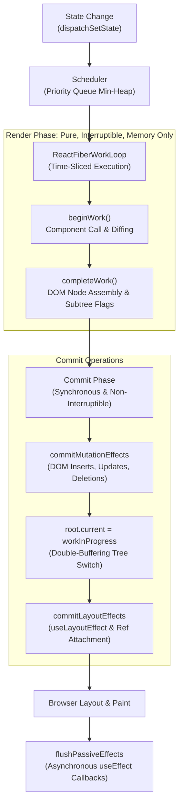

### 2. MUI Monorepo Package Relationships

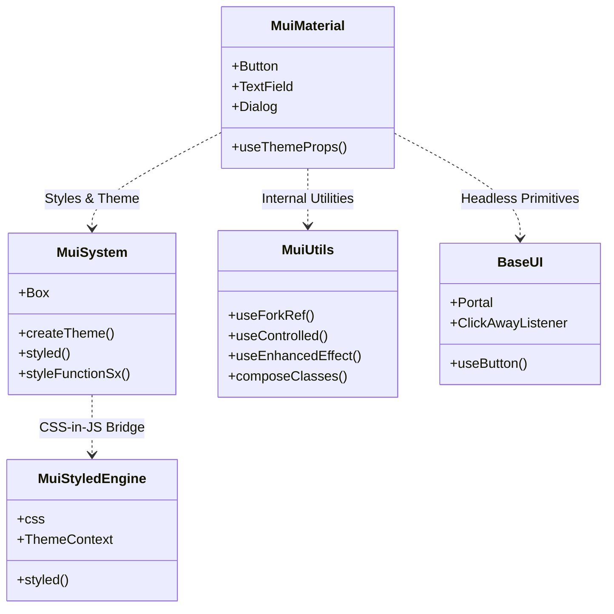

### 3. MUI Component Internal Execution

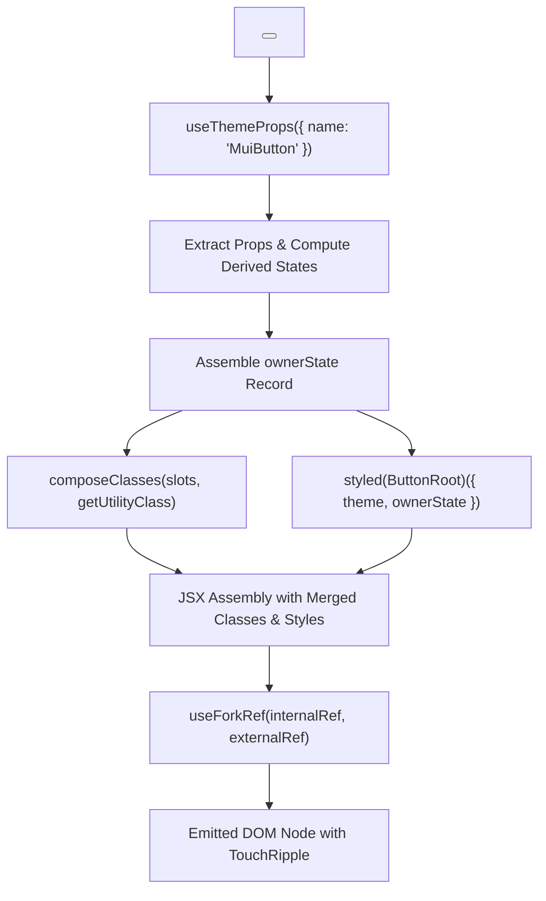

### 4. Theme & Styling Resolution

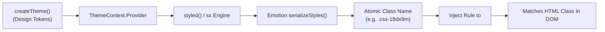

### 5. End-to-End Rendering Lifecycle

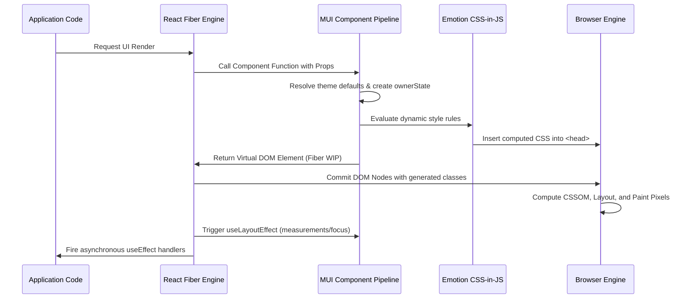

---

## 10. Final Comparison Table & Open-Source Contribution Roadmap

### Comprehensive Comparison

| Architectural Dimension | React | Material UI (MUI) |
|---|---|---|
| **Core Abstraction** | Fiber node tree representing components, state, and host elements. | Semantic design-system components organized into styled slots. |
| **State Management** | Primitive hook linked-list (`useState`, `useReducer`) on Fibers. | Prop normalization, `ownerState` pipelines, and `useControlled` state synchronization. |
| **Rendering Strategy** | Two-phase cooperative execution (interruptible Render + synchronous Commit). | Pre-render prop resolution, slot delegation, and class composition. |
| **Styling Engine** | Style-agnostic. Operates purely on `style` attributes and `className` strings. | `@mui/system` + `@mui/styled-engine` (Emotion/SC) compiling theme tokens to atomic CSS. |
| **Accessibility (A11y)** | Provides raw ARIA and event binding primitives. | Implements complete WAI-ARIA authoring practices, focus rings, and keyboard interaction specs. |
| **Theme Management** | Provides `React.createContext` without opinion on structure. | Enterprise token hierarchy: palette, typography, spacing, breakpoints, components overrides. |
| **DOM Interaction** | Synthetic Event system registered on the container root, reconciler-driven mutation. | Low-level DOM ref utilities (`useForkRef`), focus management, portals, and ripple canvas. |

---

### Open-Source Contributor Roadmap for MUI

If you are a React developer seeking to master MUI internals and contribute to the open-source repository:

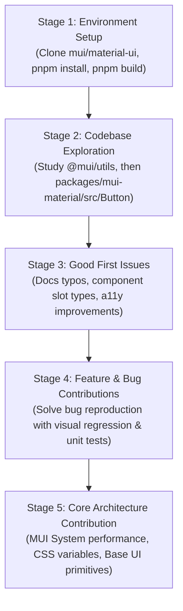

1. **Local Setup**:
   - Fork and clone [mui/material-ui](https://github.com/mui/material-ui).
   - Use `pnpm install` and run `pnpm docs:dev` to run the documentation and testing workbench locally.
2. **Master the Test Suite**:
   - `pnpm test:unit`: Vitest/Mocha unit test validation.
   - `pnpm test:karma`: Cross-browser behavior tests.
   - `pnpm test:regressions`: Visual regression testing using Argos-CI.
3. **Recommended First PR Targets**:
   - TypeScript definition enhancements in `*.d.ts` files.
   - Accessibility ARIA attribute fixes.
   - Missing component slot prop forwarding.
4. **Code Quality Conventions**:
   - Strictly avoid adding new direct dependencies.
   - Ensure every component uses `useThemeProps` and exposes `ownerState` properly.
   - Write accompanying test cases in `<Component>.test.js`.
